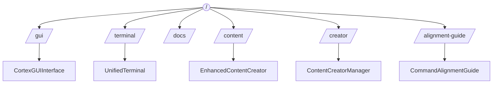
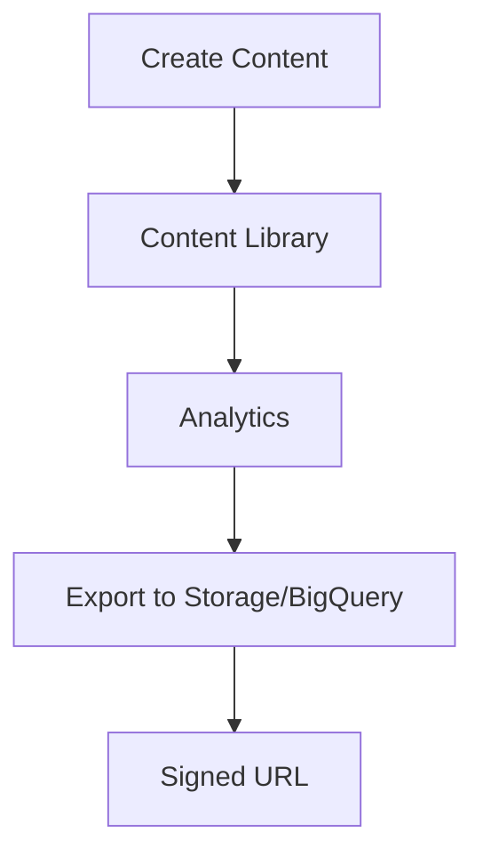
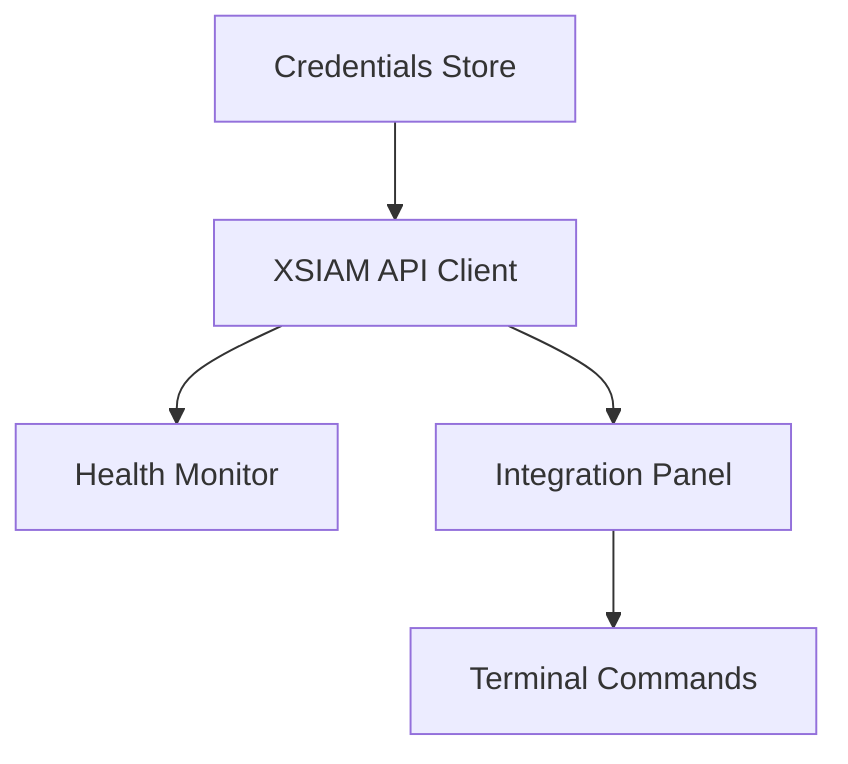
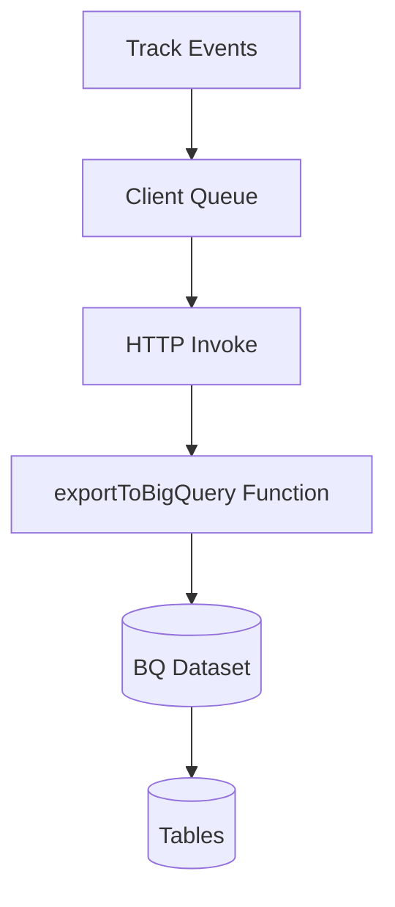

# Graph Mapping (Mermaid)

This file provides system, lifecycle, and component graphs to assist future reconstruction. Diagrams are high-level and align to the Inventory and Code Index.

System Architecture
```mermaid path=null start=null
graph TD
  A[Next.js App (Static Export)] --> B[Firebase Hosting]
  B --> C[Cloud Functions]
  C --> D[Firestore]
  C --> E[Storage]
  C --> F[DataConnect]
  C --> G[Vertex/GenAI]
  C --> H[BigQuery]
  C --> I[XSIAM API]
  A --> J[Browser Client]
  J -->|HTTP| C
```

Routing and Interface Graph (App Router)


Terminal Command System
```mermaid path=null start=null
graph TD
  Input[User Input] --> Parser[Arg Parser]
  Parser --> Registry[Command Registry]
  Registry -->|core/ext| Handlers[Command Handlers]
  Handlers -->|async| Services[External Services]
  Services --> CF[Cloud Functions]
  Services --> FB[Firebase (Auth/DB/Storage)]
  Services --> BQ[BigQuery]
  Services --> XI[XSIAM API]
  Handlers --> Output[TerminalOutput]
```

Scenario Engine Lifecycle
```mermaid path=null start=null
graph TD
  Gen[scenario generate] --> Deploy[scenario deploy]
  Deploy --> Status[scenario status]
  Status -->|complete| Validate[scenario validate]
  Validate --> Export[scenario export]
  Export --> Destroy[scenario destroy]
  subgraph Client (hosting)
    Gen
    Status
    Validate
    Export
    Destroy
  end
  subgraph Cloud Functions (functions)
    CFGen[generateThreatActorScenario]
    CFExec[executeScenario]
    CFStatus[scenario-status]
    CFVal[scenario-validate]
    CFExp[scenario-export]
    CFDst[scenario-destroy]
  end
  Gen --> CFGen
  Deploy --> CFExec
  Status --> CFStatus
  Validate --> CFVal
  Export --> CFExp
  Destroy --> CFDst
```

TRR Lifecycle
```mermaid path=null start=null
graph TD
  Create[Create TRR] --> Validate[Validate / Evidence]
  Validate --> AI[AI Assist (Vertex/Genkit/OpenAI)]
  Validate --> Signoff[Blockchain Signoff]
  Signoff --> Export[Export (PDF/JSON)]
  Export --> Archive[Archive]
  subgraph UI
    Create
    Validate
    Export
  end
  subgraph Functions
    AI
    Signoff
  end
```

Content Hub Flow


XSIAM Integration


BigQuery Export Pipeline

