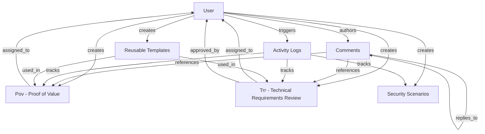
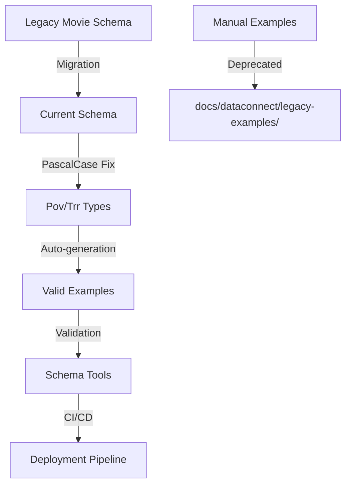
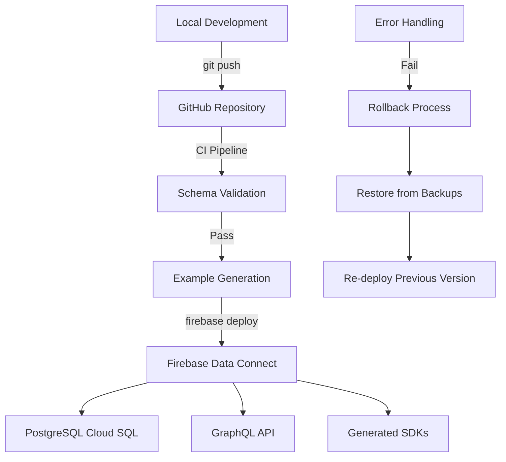

# Firebase Data Connect Architecture

## Overview

Firebase Data Connect provides a GraphQL API layer over PostgreSQL for the Cortex DC Portal, enabling secure and efficient data access for POV management, TRR validation, and security scenario orchestration.

### Core Components

- **Schema**: GraphQL type definitions in `dataconnect/schema/schema.gql`
- **Connectors**: Client SDK generation configurations in `dataconnect/example/connector.yaml`
- **Examples**: Auto-generated GraphQL operations in `dataconnect/example/`
- **Database**: PostgreSQL Cloud SQL instance (`henryreedai-fdc`)

### Service Configuration

```yaml
Service ID: henryreedai
Location: us-east1
Database: fdcdb (PostgreSQL)
Cloud SQL Instance: henryreedai-fdc
```

## Entity Relationships

### Primary Entities

The schema defines 7 main entity types with clear ownership and relationship patterns:



### Data Flow Architecture

```mermaid
graph LR
    A[Client Apps] --> B[Firebase Data Connect]
    B --> C[GraphQL API]
    C --> D[PostgreSQL]
    
    B --> E[Generated SDKs]
    E --> F[React App]
    E --> G[Cloud Functions]
    E --> H[BigQuery Export]
    
    I[Auth] --> |Firebase Auth| B
    J[Security Rules] --> |@auth directives| C
```

### Schema Evolution



## Entity Definitions

### User
**Purpose**: Firebase Auth integration for user management
- **Primary Key**: `id: String!` (Firebase Auth UID)
- **Required Fields**: `email`, `createdAt`, `isActive`
- **Relationships**: One-to-many with all other entities as creator/assignee

### Pov (Proof of Value)
**Purpose**: POV project management and tracking
- **Primary Key**: `id: UUID!`
- **Required Fields**: `name`, `customer`, `useCase`, `status`
- **Relationships**: 
  - `createdBy: User!` (Creator)
  - `assignedTo: User` (Optional assignee)
- **Status Values**: `draft`, `active`, `completed`, `cancelled`

### Trr (Technical Requirements Review)
**Purpose**: Technical validation and requirements documentation
- **Primary Key**: `id: UUID!`
- **Required Fields**: `title`, `description`, `category`, `status`, `priority`
- **Relationships**: 
  - `createdBy: User!` (Creator)
  - `assignedTo: User` (Optional assignee)
  - `approvedBy: User` (Optional approver)
- **Approval Flow**: `draft` → `review` → `approved`/`rejected`

### Scenario
**Purpose**: Security scenario and attack simulation management
- **Primary Key**: `id: UUID!`
- **Required Fields**: `name`, `description`, `type`, `platform`, `status`, `severity`
- **Relationships**: `createdBy: User!`
- **Types**: `cloud-posture`, `container-vuln`, `code-vuln`, `insider-threat`, `ransomware`

### ActivityLog
**Purpose**: Audit trail and activity tracking
- **Primary Key**: `id: UUID!`
- **Required Fields**: `entityType`, `entityId`, `action`, `userId`
- **Relationships**: `userId: User!`
- **Auto-capture**: IP address, user agent, timestamp

### Comment
**Purpose**: Threaded discussions on POVs and TRRs
- **Primary Key**: `id: UUID!`
- **Required Fields**: `content`, `entityType`, `entityId`, `author`
- **Relationships**: 
  - `author: User!`
  - `parentComment: Comment` (Optional, for threading)

### Template
**Purpose**: Reusable content for POVs and TRRs
- **Primary Key**: `id: UUID!`
- **Required Fields**: `name`, `type`, `content`
- **Relationships**: `createdBy: User!`
- **Visibility**: `isPublic: Boolean!` for sharing control

## Naming Conventions

### Schema Types
- **PascalCase**: All type names follow PascalCase (e.g., `Pov`, `Trr`, not `POV`, `TRR`)
- **Descriptive**: Type names clearly indicate their purpose
- **Consistent**: Related types follow similar patterns

### GraphQL Operations
- **camelCase**: Auto-generated operations use camelCase (e.g., `activityLog`, not `activitylog`)
- **Predictable**: Standard CRUD operations follow Firebase patterns
  - Queries: `entity`, `entities`
  - Mutations: `entity_insert`, `entity_upsert`, `entity_delete`

### Database Fields
- **snake_case**: PostgreSQL fields use snake_case for SQL compatibility
- **Foreign Keys**: Auto-generated as `{field}Id` (e.g., `createdById`, `authorId`)
- **Expressions**: Use `_expr` suffix for server-side expressions (e.g., `createdById_expr: "auth.uid"`)

## Security Model

### Authentication
- **Firebase Auth**: All operations require authenticated users
- **@auth Directives**: Control access at operation level
- **User Scoping**: Most operations implicitly scope to current user

### Authorization Patterns
```graphql
# Public read access (with reason)
query ListPublicTemplates @auth(level: PUBLIC, insecureReason: "Templates are public by design") {
  templates(where: { isPublic: { eq: true } }) { ... }
}

# User-scoped operations
query GetMyPovs @auth(level: USER) {
  povs(where: { createdBy: { id: { eq_expr: "auth.uid" } } }) { ... }
}

# Admin-only operations
query ListAllUsers @auth(level: NO_ACCESS) {
  users { ... }
}
```

### Data Protection
- **Row Level Security**: Implicit through GraphQL resolvers
- **Field Level Security**: Sensitive fields protected via schema design
- **Audit Trail**: All mutations logged in ActivityLog

## Generated SDKs

### Targets
1. **Root SDK**: `src/dataconnect-generated/` (Node.js compatible)
2. **Hosting SDK**: `hosting/src/dataconnect-generated/` (React optimized)
3. **Functions SDK**: `functions/src/dataconnect-generated/` (Cloud Functions)
4. **BigQuery Export**: `hosting/cloud-functions/bigquery-export/src/dataconnect-generated/`

### Usage Patterns
```typescript
// React component usage
import { listPovs, createPov } from '@/dataconnect-generated';

const povs = await listPovs();
const newPov = await createPov({
  name: "Customer POV",
  customer: "Acme Corp",
  useCase: "Security validation",
  // createdById automatically set via auth.uid
});
```

## Automated Tooling

### Schema Validation
- **Tool**: `tools/validate-schema.mjs`
- **Purpose**: Syntax checking, PascalCase validation
- **Usage**: `npm run dc:validate`

### Example Generation
- **Tool**: `tools/generate-graphql-examples.mjs`
- **Purpose**: Auto-generate valid examples from schema
- **Usage**: `npm run dc:generate`
- **Benefits**: Prevents schema-example drift

### CI Integration
```json
{
  "scripts": {
    "dc:validate": "node tools/validate-schema.mjs",
    "dc:generate": "node tools/generate-graphql-examples.mjs",
    "precommit": "npm run dc:validate"
  }
}
```

## Migration Notes

### Legacy Movie Schema
The original Firebase Data Connect example used a movie database schema. This has been completely replaced with the current POV/TRR/Scenario schema.

**Preserved Legacy Files**:
- `docs/dataconnect/legacy-examples/queries.legacy.gql`
- `docs/dataconnect/legacy-examples/mutations.legacy.gql`

**Migration Actions Taken**:
1. Schema type renaming for PascalCase compliance
2. Complete rewrite of example operations
3. Foreign key relationship fixes
4. Authentication directive alignment

### Breaking Changes Acknowledged
During deployment, Firebase flagged breaking changes from the migration:
- Removed operations: `CreatePOV`, `ListPOVs`, `GetPOVById`, etc.
- Security warnings: New operations lacking `insecureReason` attributes
- Schema evolution: POV→Pov, TRR→Trr type renames

These were acknowledged and deployed successfully on 2025-10-07.

## Deployment Architecture



## Best Practices

### Schema Design
1. **Always use PascalCase** for type names
2. **Include audit fields** (`createdAt`, `updatedAt`)
3. **Explicit relationships** with proper foreign keys
4. **Required vs optional** fields should match business logic

### Example Maintenance
1. **Never hand-edit** generated examples
2. **Run generator** after schema changes
3. **Validate before deploy** using tooling
4. **Document custom queries** separately

### Security
1. **Always use @auth directives** on operations
2. **Provide insecureReason** for public operations
3. **Scope operations to users** where possible
4. **Log sensitive operations** in ActivityLog

### Performance
1. **Limit query depth** to prevent N+1 problems
2. **Use specific field selection** rather than full objects
3. **Index foreign key fields** in PostgreSQL
4. **Monitor query performance** in Firebase Console

## Troubleshooting

### Common Issues

**Schema Validation Errors**:
- Run `npm run dc:validate` to check syntax
- Ensure PascalCase type naming
- Verify field type consistency

**Deployment Failures**:
- Check Firebase project permissions
- Validate PostgreSQL connectivity
- Review breaking change warnings

**Generated SDK Issues**:
- Regenerate after schema changes
- Clear build caches (`.next`, `node_modules/.cache`)
- Verify connector configuration paths

**Query Performance**:
- Use Firebase Console query analyzer
- Optimize PostgreSQL indexes
- Review relationship traversal patterns

This architecture documentation reflects the current state as of the successful Data Connect deployment on 2025-10-07.