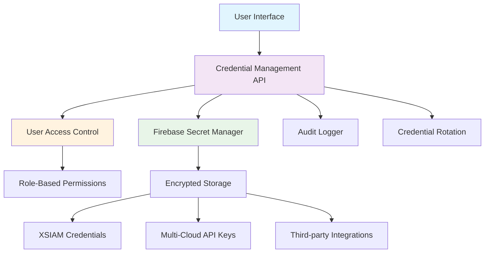
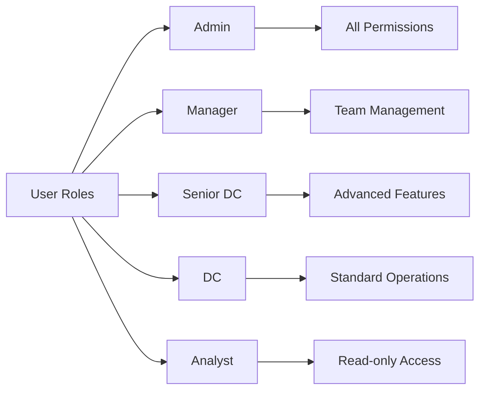
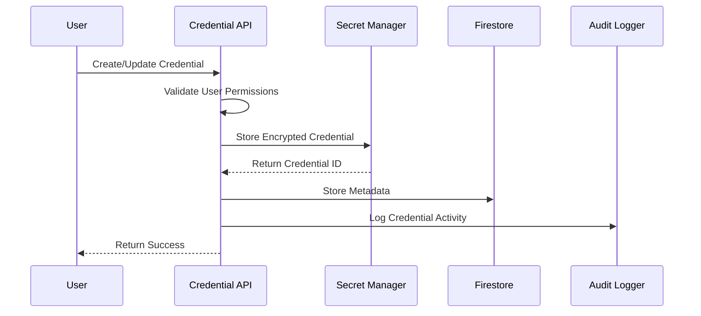

# Enterprise Credential Management System Design

## Overview

This document describes the comprehensive credential store architecture needed for enterprise-grade user-level credential handling, supporting XSIAM API integration, health checks, multi-cloud API keys, and role-based access control for the henryreed.ai platform.

## Current State Analysis

### Existing Implementation
- **XSIAM Credentials**: Basic client-side encrypted storage (`hosting/lib/xsiam-api-service.ts`)
- **User Roles**: Five-tier role system (admin, manager, senior_dc, dc, analyst)
- **Firestore Rules**: Organization-based access control with role validation
- **Firebase Auth**: Token-based authentication with custom claims

### Limitations of Current System
- Client-side credential storage is insecure for production
- No centralized credential management across APIs
- Missing credential rotation and lifecycle management
- Limited audit trail for credential access
- No credential sharing between team members

## Proposed Enterprise Credential Management Architecture



## Credential Types and Categories

### 1. XSIAM API Credentials
```typescript
interface XSIAMCredentials {
  id: string;
  name: string;
  description?: string;
  
  // Connection Details
  apiAddress: string;
  apiId: string;
  apiKey: string;  // Encrypted at rest
  tenantName: string;
  region: string;
  
  // Metadata
  ownerId: string;
  organizationId: string;
  sharedWith: string[]; // User IDs with access
  
  // Lifecycle
  createdAt: string;
  updatedAt: string;
  lastUsed?: string;
  lastTested?: string;
  expiresAt?: string;
  
  // Status
  isActive: boolean;
  isValid?: boolean;
  healthStatus: 'healthy' | 'warning' | 'error' | 'unknown';
  
  // Access Control
  accessLevel: 'personal' | 'team' | 'organization';
  allowedRoles: UserRole[];
  
  // Security
  rotationSchedule?: 'manual' | 'monthly' | 'quarterly';
  lastRotation?: string;
  rotationRequired?: boolean;
}
```

### 2. Multi-Cloud API Keys
```typescript
interface CloudCredentials {
  id: string;
  name: string;
  provider: 'aws' | 'gcp' | 'azure' | 'kubernetes';
  credentialType: 'api_key' | 'service_account' | 'access_token' | 'certificate';
  
  // Provider-specific fields
  credentials: {
    // AWS
    accessKeyId?: string;
    secretAccessKey?: string;  // Encrypted
    sessionToken?: string;
    region?: string;
    
    // GCP
    serviceAccountKey?: string;  // Encrypted JSON
    projectId?: string;
    
    // Azure
    clientId?: string;
    clientSecret?: string;  // Encrypted
    tenantId?: string;
    subscriptionId?: string;
    
    // Kubernetes
    kubeconfig?: string;  // Encrypted
    context?: string;
    namespace?: string;
  };
  
  // Standard fields
  ownerId: string;
  organizationId: string;
  sharedWith: string[];
  createdAt: string;
  updatedAt: string;
  lastUsed?: string;
  expiresAt?: string;
  isActive: boolean;
  accessLevel: 'personal' | 'team' | 'organization';
  allowedRoles: UserRole[];
}
```

### 3. Third-party Integration Credentials
```typescript
interface ThirdPartyCredentials {
  id: string;
  name: string;
  service: 'github' | 'cal.com' | 'bigquery' | 'custom';
  
  credentials: {
    // GitHub
    personalAccessToken?: string;  // Encrypted
    installationId?: string;
    
    // Cal.com
    apiKey?: string;  // Encrypted
    userId?: string;
    
    // BigQuery
    serviceAccount?: string;  // Encrypted JSON
    datasetId?: string;
    
    // Custom service
    apiKey?: string;  // Encrypted
    endpoint?: string;
    headers?: Record<string, string>;
  };
  
  // Standard fields
  ownerId: string;
  organizationId: string;
  sharedWith: string[];
  createdAt: string;
  updatedAt: string;
  lastUsed?: string;
  expiresAt?: string;
  isActive: boolean;
  accessLevel: 'personal' | 'team' | 'organization';
  allowedRoles: UserRole[];
}
```

## Role-Based Access Control Matrix

### User Roles and Capabilities



### Detailed Permission Matrix

| Capability | Admin | Manager | Senior DC | DC | Analyst |
|------------|-------|---------|-----------|----|---------| 
| **XSIAM Credentials** |
| Create personal | ✅ | ✅ | ✅ | ✅ | ✅ |
| Create team | ✅ | ✅ | ✅ | ❌ | ❌ |
| Create organization | ✅ | ❌ | ❌ | ❌ | ❌ |
| View own | ✅ | ✅ | ✅ | ✅ | ✅ |
| View team | ✅ | ✅ | ✅ | ❌ | ❌ |
| View organization | ✅ | ❌ | ❌ | ❌ | ❌ |
| Edit own | ✅ | ✅ | ✅ | ✅ | ✅ |
| Edit team | ✅ | ✅ | ❌ | ❌ | ❌ |
| Delete own | ✅ | ✅ | ✅ | ✅ | ✅ |
| Delete team | ✅ | ✅ | ❌ | ❌ | ❌ |
| Share credentials | ✅ | ✅ | ✅ | ❌ | ❌ |
| **Cloud API Keys** |
| AWS credentials | ✅ | ✅ | ✅ | ✅ | View only |
| GCP credentials | ✅ | ✅ | ✅ | ✅ | View only |
| Azure credentials | ✅ | ✅ | ✅ | ✅ | View only |
| Kubernetes config | ✅ | ✅ | ✅ | ❌ | ❌ |
| **Third-party APIs** |
| GitHub integration | ✅ | ✅ | ✅ | ✅ | View only |
| Cal.com integration | ✅ | ✅ | ✅ | ✅ | ❌ |
| BigQuery access | ✅ | ✅ | ✅ | ❌ | ❌ |
| Custom integrations | ✅ | ✅ | ❌ | ❌ | ❌ |
| **Management Functions** |
| User credential audit | ✅ | Team only | Own only | Own only | Own only |
| Credential rotation | ✅ | Team only | Own only | Own only | ❌ |
| Health monitoring | ✅ | ✅ | ✅ | ✅ | View only |
| Usage analytics | ✅ | Team only | Own only | Own only | ❌ |
| **Advanced Security** |
| Audit log access | ✅ | Team only | ❌ | ❌ | ❌ |
| Compliance reports | ✅ | ✅ | ❌ | ❌ | ❌ |
| Security settings | ✅ | ❌ | ❌ | ❌ | ❌ |
| Emergency revocation | ✅ | ✅ | ❌ | ❌ | ❌ |

## Credential Storage Architecture

### Security Model


### Firestore Data Structure
```
/organizations/{orgId}/credentials/{credId}
├── metadata (public data)
│   ├── id: string
│   ├── name: string
│   ├── description: string
│   ├── type: 'xsiam' | 'cloud' | 'third_party'
│   ├── provider: string
│   ├── ownerId: string
│   ├── sharedWith: string[]
│   ├── accessLevel: string
│   ├── allowedRoles: string[]
│   ├── isActive: boolean
│   ├── healthStatus: string
│   ├── createdAt: timestamp
│   ├── updatedAt: timestamp
│   ├── lastUsed: timestamp
│   └── expiresAt: timestamp
└── audit/
    └── {activityId}: activity records
```

### Secret Manager Structure
```
projects/{project}/secrets/
├── xsiam-{credentialId}
├── aws-{credentialId}  
├── gcp-{credentialId}
├── azure-{credentialId}
├── github-{credentialId}
├── cal-{credentialId}
└── bigquery-{credentialId}
```

## Implementation Components

### 1. Credential Management Service
```typescript
export class EnterpriseCredentialService {
  private secretManager: SecretManagerServiceClient;
  private firestore: Firestore;
  private auditLogger: AuditLogger;

  // Core CRUD operations
  async createCredential(credential: CredentialInput, userId: string): Promise<string>
  async getCredential(credentialId: string, userId: string): Promise<DecryptedCredential>
  async updateCredential(credentialId: string, updates: Partial<CredentialInput>, userId: string): Promise<void>
  async deleteCredential(credentialId: string, userId: string): Promise<void>
  
  // Access control
  async shareCredential(credentialId: string, userIds: string[], permissions: Permission[]): Promise<void>
  async revokeAccess(credentialId: string, userIds: string[]): Promise<void>
  
  // Health and monitoring
  async testCredential(credentialId: string): Promise<HealthResult>
  async getCredentialHealth(credentialId: string): Promise<HealthStatus>
  async rotateCredential(credentialId: string): Promise<void>
  
  // Bulk operations
  async listUserCredentials(userId: string, filters: CredentialFilters): Promise<CredentialMetadata[]>
  async bulkTestCredentials(credentialIds: string[]): Promise<HealthResult[]>
  async getExpiringCredentials(daysAhead: number): Promise<CredentialMetadata[]>
}
```

### 2. Role-Based Access Control
```typescript
export class CredentialAccessControl {
  async validateAccess(
    userId: string, 
    credentialId: string, 
    operation: 'read' | 'write' | 'delete' | 'share'
  ): Promise<boolean>
  
  async getUserPermissions(userId: string, credentialId: string): Promise<Permission[]>
  
  async getAccessibleCredentials(
    userId: string, 
    filters: CredentialFilters
  ): Promise<CredentialMetadata[]>
  
  async validateRolePermissions(
    userRole: UserRole, 
    operation: string, 
    resourceType: string
  ): Promise<boolean>
}
```

### 3. Credential Health Monitor
```typescript
export class CredentialHealthMonitor {
  async runHealthChecks(): Promise<void>
  async testXSIAMCredentials(credentials: XSIAMCredentials[]): Promise<HealthResult[]>
  async testCloudCredentials(credentials: CloudCredentials[]): Promise<HealthResult[]>
  async generateHealthReport(organizationId: string): Promise<HealthReport>
  async scheduleRotation(credentialId: string, schedule: RotationSchedule): Promise<void>
}
```

### 4. Audit and Compliance
```typescript
export class CredentialAuditService {
  async logCredentialAccess(userId: string, credentialId: string, operation: string): Promise<void>
  async generateComplianceReport(organizationId: string, period: string): Promise<ComplianceReport>
  async getAuditTrail(credentialId: string): Promise<AuditEntry[]>
  async detectSuspiciousActivity(): Promise<SecurityAlert[]>
}
```

## User Interface Components

### 1. Credential Management Dashboard
```typescript
// Component: CredentialManagementDashboard
interface DashboardProps {
  userRole: UserRole;
  organizationId: string;
}

// Features:
// - Credential overview cards
// - Health status indicators  
// - Quick actions (create, test, rotate)
// - Recent activity timeline
// - Expiration warnings
```

### 2. Credential Creation Wizard
```typescript
// Component: CredentialWizard
interface WizardProps {
  credentialType: 'xsiam' | 'cloud' | 'third_party';
  allowedProviders: string[];
  userPermissions: Permission[];
}

// Multi-step wizard:
// Step 1: Credential type selection
// Step 2: Provider-specific configuration
// Step 3: Access control settings
// Step 4: Testing and validation
// Step 5: Review and create
```

### 3. Team Sharing Interface
```typescript
// Component: CredentialSharingPanel
interface SharingProps {
  credentialId: string;
  currentShares: SharedAccess[];
  availableUsers: UserProfile[];
}

// Features:
// - User search and selection
// - Permission level assignment
// - Expiration date setting
// - Bulk sharing operations
```

### 4. Health Monitoring View
```typescript
// Component: CredentialHealthMonitor
interface MonitorProps {
  credentials: CredentialMetadata[];
  healthData: HealthStatus[];
  alertSettings: AlertConfiguration;
}

// Real-time health dashboard:
// - Connection status indicators
// - Response time metrics
// - Error rate tracking
// - Automatic testing results
// - Alert configuration
```

## Security Considerations

### Encryption at Rest
- All sensitive credential data encrypted using Google Cloud KMS
- Separate encryption keys per organization
- Key rotation every 90 days
- Hardware Security Module (HSM) backing

### Encryption in Transit
- TLS 1.3 for all API communications
- Certificate pinning for critical connections
- Mutual TLS authentication for service-to-service calls

### Access Patterns
- Principle of least privilege
- Time-based access expiration
- IP address restrictions
- Multi-factor authentication for sensitive operations

### Audit Requirements
- All credential access logged
- Immutable audit trails
- Real-time anomaly detection
- Compliance reporting (SOC 2, ISO 27001)

## Deployment Architecture

### Firebase Functions
```typescript
// Credential management functions
export const createCredential = functions.https.onCall(createCredentialHandler);
export const getCredential = functions.https.onCall(getCredentialHandler);
export const updateCredential = functions.https.onCall(updateCredentialHandler);
export const deleteCredential = functions.https.onCall(deleteCredentialHandler);
export const testCredential = functions.https.onCall(testCredentialHandler);
export const shareCredential = functions.https.onCall(shareCredentialHandler);

// Background processing
export const credentialHealthCheck = functions.pubsub.schedule('every 1 hours').onRun(healthCheckHandler);
export const credentialRotation = functions.pubsub.schedule('0 2 * * *').onRun(rotationHandler);
export const auditProcessing = functions.firestore.document('audit/{auditId}').onCreate(auditHandler);
```

### Firestore Security Rules Update
```javascript
// Enhanced rules for credential management
match /organizations/{orgId}/credentials/{credId} {
  allow read: if isAuthenticated() && 
              (isCredentialOwner(credId) || 
               isSharedWith(credId) || 
               hasRole(['admin', 'manager']));
               
  allow create: if isAuthenticated() && 
                isValidCredentialData() &&
                hasPermission('credential.create');
                
  allow update: if isAuthenticated() && 
                (isCredentialOwner(credId) || hasRole('admin')) &&
                isValidCredentialUpdate();
                
  allow delete: if isAuthenticated() && 
                (isCredentialOwner(credId) || hasRole('admin'));
}
```

## Migration Strategy

### Phase 1: Infrastructure Setup (Week 1)
- Deploy Secret Manager integration
- Update Firestore security rules
- Create credential management Firebase Functions
- Implement basic UI components

### Phase 2: XSIAM Integration (Week 2)
- Migrate existing XSIAM credentials
- Implement health monitoring
- Add sharing capabilities
- Create audit trails

### Phase 3: Multi-Cloud Support (Week 3)
- Add AWS, GCP, Azure credential types
- Implement provider-specific health checks
- Create credential testing workflows
- Add bulk operations

### Phase 4: Advanced Features (Week 4)
- Implement credential rotation
- Add compliance reporting
- Create admin management tools
- Deploy monitoring and alerting

## Benefits of Enterprise Credential Management

### Security Improvements
- ✅ Centralized credential storage
- ✅ Encryption at rest and in transit
- ✅ Role-based access control
- ✅ Audit trails and compliance
- ✅ Automated credential rotation

### Operational Benefits
- ✅ Team credential sharing
- ✅ Centralized health monitoring
- ✅ Automated testing and validation
- ✅ Unified management interface
- ✅ Bulk operations support

### Compliance Features
- ✅ SOC 2 Type II compliance ready
- ✅ ISO 27001 audit trails
- ✅ GDPR data handling
- ✅ Role-based access logging
- ✅ Immutable audit records

This comprehensive credential management system transforms the platform from basic client-side storage to enterprise-grade credential management with full security, compliance, and operational capabilities.