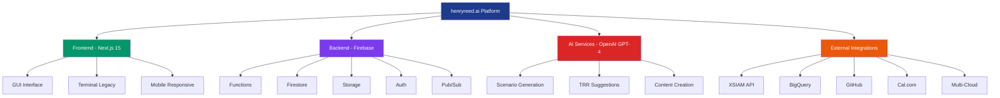
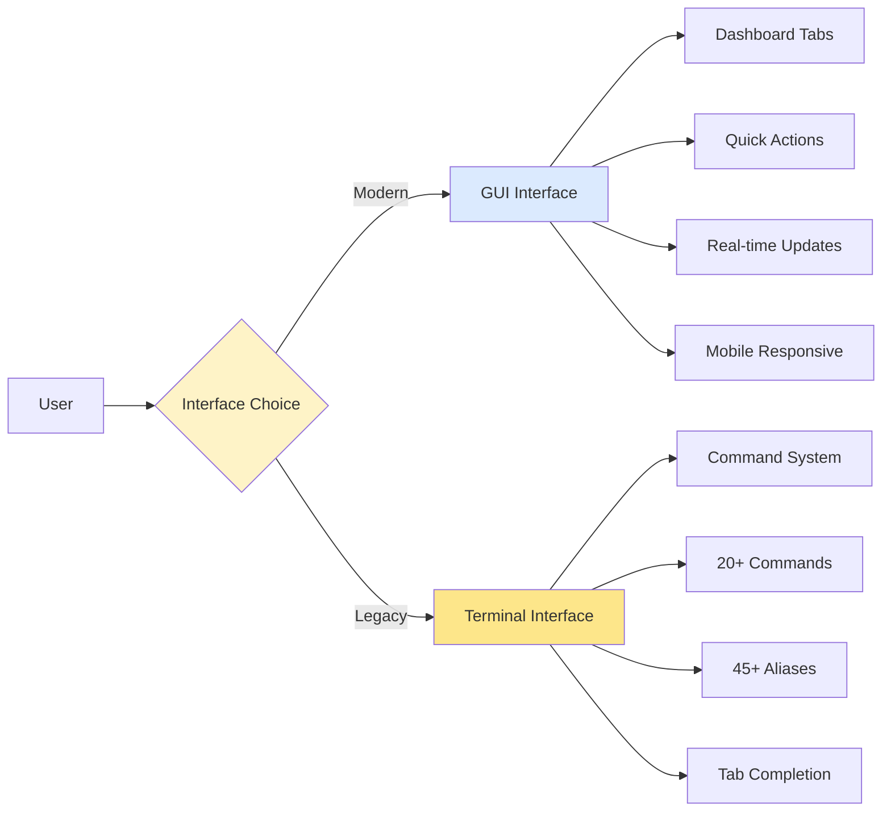
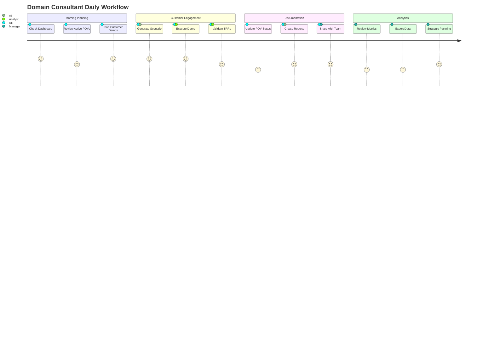
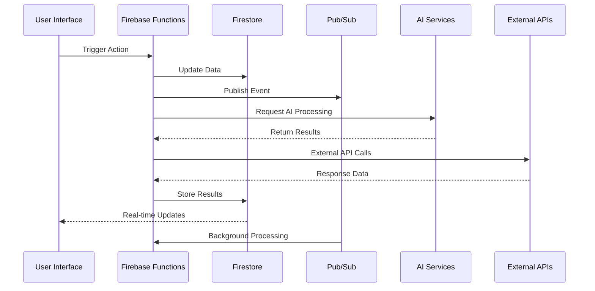
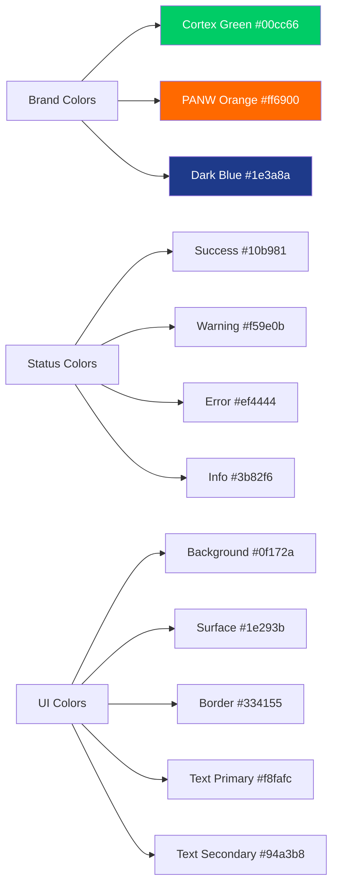
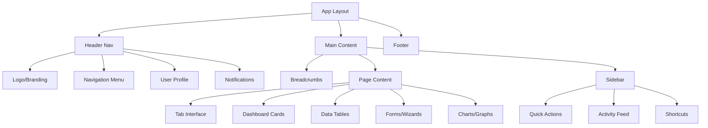
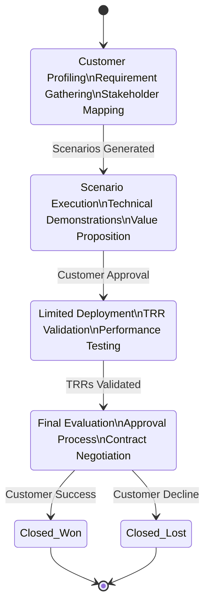
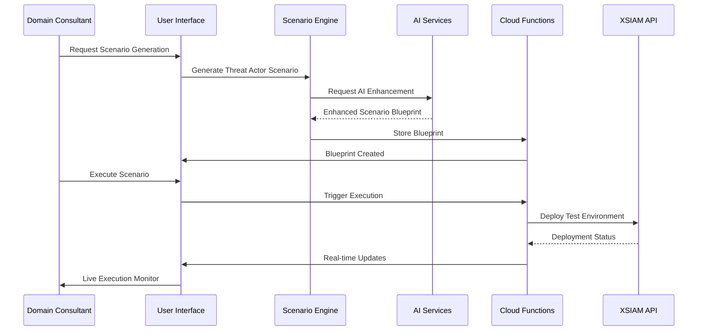
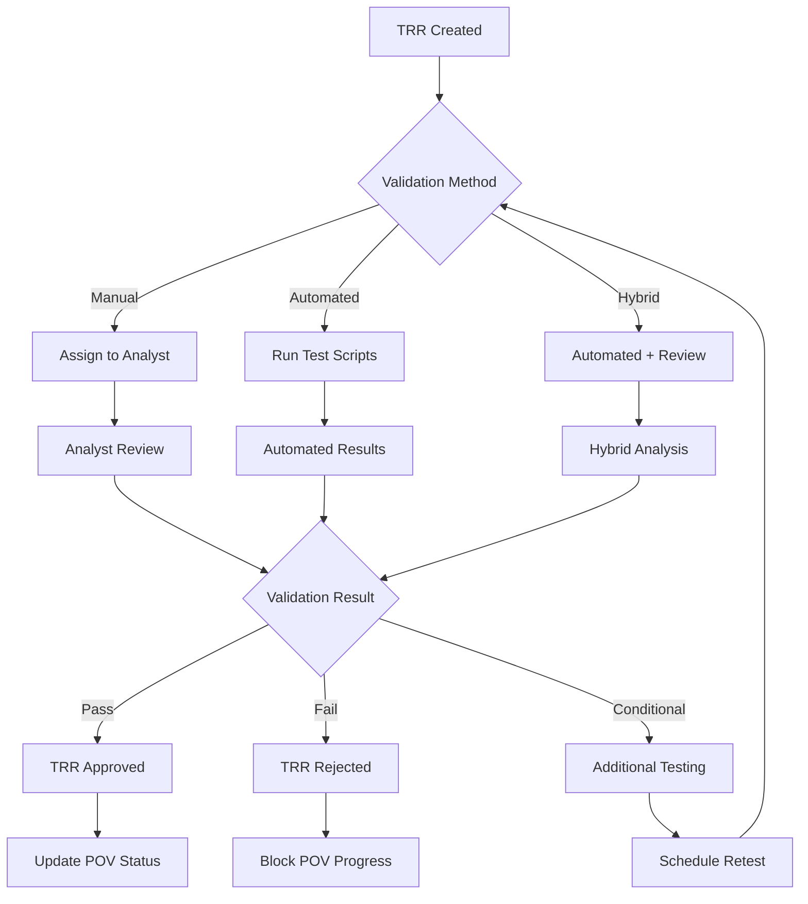

# 🎯 henryreed.ai Platform - Complete Wireframe System

## Executive Summary

This comprehensive wireframe system documents the complete henryreed.ai platform, a sophisticated Domain Consultant (DC) engagement portal designed to prove XSIAM platform value to customers. The platform has evolved from a terminal-based system to a full-featured GUI application with AI-powered scenario generation, comprehensive TRR management, real-time health monitoring, and enterprise-grade credential management.

## Platform Overview



## 🗺️ Navigation Map

### 👥 [User Personas and Journeys](../personas/)
- [Persona Definitions](../personas/persona-definitions.md)
- [Domain Consultant Journey](../journeys/domain-consultant-journey.md)
- [Security Analyst Journey](../journeys/security-analyst-journey.md) 
- [Manager Journey](../journeys/manager-journey.md)

### 📋 [Feature Documentation](../features/)
- [Feature Overview](../features/README.md)
- [POV Management System](../features/pov-management.md)
- [TRR Management Workflows](../features/trr-management.md)
- [Scenario Engine](../features/scenario-engine.md)
- [XSIAM Health Monitoring](../features/xsiam-monitoring.md)
- [BigQuery Data Explorer](../features/bigquery-explorer.md)
- [Content Creation Hub](../features/content-creation.md)
- [AI Assistant](../features/ai-assistant.md)

### 🏗️ [System Architecture](../architecture/)
- [Architecture Overview](../architecture/overview.md)
- [Data Flow Patterns](../architecture/data-flows.md)
- [Real-time Systems](../architecture/real-time-systems.md)
- [Integration Patterns](../architecture/integrations.md)

### 🔐 [Security and Access Control](../security/)
- [Enterprise Credential Management](../security/credential-management-system.md)
- [Role-Based Access Control](../security/security-and-rbac.md)
- [Multi-tenant Architecture](../security/multi-tenant-design.md)

### 🖼️ [User Interface Wireframes](../wireframes/)
- [Main Dashboard](wireframes/main-dashboard.md)
- [POV Lifecycle Board](wireframes/pov-lifecycle.md)
- [Scenario Generation Wizard](wireframes/scenario-wizard.md)
- [TRR Validation Workflow](wireframes/trr-workflow.md)
- [XSIAM Health Dashboard](wireframes/xsiam-dashboard.md)
- [Data Export Interface](wireframes/data-export.md)
- [Terminal Interface](wireframes/terminal-interface.md)

### 📊 [Data Models and APIs](../inventory/)
- [Feature Inventory](../inventory/feature-inventory.md)
- [Data Models](../inventory/data-models-and-events.md)
- [Command System](../inventory/command-crosswalk.md)

### 🗓️ [Evolution and Roadmap](../roadmap/)
- [Evolution Timeline](../roadmap/evolution-and-roadmap.md)
- [Unfinished Work](../roadmap/unfinished-work.md)
- [Future Enhancements](../roadmap/future-roadmap.md)

---

## 🎨 Core Features Overview

### 1. Multi-Interface Platform Architecture



### 2. Core Business Capabilities

| Feature | Description | Key Users | Status |
|---------|-------------|-----------|--------|
| **POV Management** | Complete Proof-of-Value lifecycle tracking | DC, Manager | ✅ Production |
| **TRR Workflows** | Technical Risk Review validation system | DC, Analyst | ✅ Production |
| **Scenario Engine** | AI-powered security scenario generation | DC, Analyst | ✅ Production |
| **XSIAM Health** | Real-time platform health monitoring | DC, Analyst | ✅ Production |
| **Data Explorer** | BigQuery analytics and export platform | Manager, DC | ✅ Production |
| **Content Hub** | Unified content creation and management | DC, Manager | ✅ Production |
| **AI Assistant** | Context-aware recommendations and chat | All Users | ✅ Production |
| **Credential Store** | Enterprise credential management | All Users | 🚧 Planned |

### 3. User Experience Architecture



---

## 🏢 Enterprise Architecture Patterns

### Multi-Tenant Organization Model

```mermaid
classDiagram
    class Organization {
        +string id
        +string name
        +string plan
        +UserProfile[] members
        +Settings settings
        +Credentials[] credentials
    }
    
    class UserProfile {
        +string id
        +string email
        +UserRole role
        +Permissions permissions
        +Preferences preferences
        +ActivityLog[] activities
    }
    
    class POV {
        +string id
        +string customerId
        +POVStage stage
        +Milestone[] milestones
        +Scenario[] scenarios
        +TRR[] linkedTRRs
    }
    
    class TRR {
        +string id
        +TRRStatus status
        +Evidence[] evidence
        +Approval[] approvals
        +string assignedTo
    }
    
    class Scenario {
        +string id
        +ScenarioType type
        +ExecutionStatus status
        +ThreatVector[] vectors
        +DetectionRule[] rules
    }
    
    Organization ||--o{ UserProfile
    Organization ||--o{ POV
    Organization ||--o{ TRR
    POV ||--o{ Scenario
    POV ||--o{ TRR
```

### Real-Time Data Synchronization



---

## 📱 User Interface Design System

### Design Principles

1. **Cortex Brand Alignment** - Consistent with Palo Alto Networks design system
2. **Information Density** - Rich data presentation without clutter  
3. **Progressive Disclosure** - Show complexity as needed
4. **Real-time Feedback** - Live updates and status indicators
5. **Mobile-First Responsive** - Works across all device types

### Color Palette & Theming



### Component Hierarchy



---

## 🔄 Data Flow Architecture

### Primary Data Flows

#### 1. POV Management Flow


#### 2. Scenario Generation and Execution


#### 3. TRR Validation Workflow


---

## 🎯 Key Performance Indicators (KPIs)

### Business Metrics
- **POV Success Rate**: Target 75%+ (Currently tracking 12 active POVs)
- **Average POV Cycle Time**: Target <60 days (Currently 41 days average)
- **TRR Completion Rate**: Target 95%+ (Currently 156 total, 142 completed)
- **Customer Satisfaction Score**: Target 4.5/5.0
- **Time to First Demo**: Target <7 days

### Technical Metrics
- **Platform Uptime**: Target 99.9%
- **Average Response Time**: Target <300ms (Currently 247ms)
- **Scenario Success Rate**: Target 90%+ 
- **AI Recommendation Accuracy**: Target 85%+
- **Real-time Sync Latency**: Target <2 seconds

### User Experience Metrics
- **Daily Active Users**: Tracking by role (Admin: 1, Manager: 2, DC: 8)
- **Feature Adoption Rate**: Measuring usage across components
- **Session Duration**: Average engagement time per feature
- **Error Rate**: Target <5% (Currently 2.1%)
- **Help Documentation Usage**: Self-service success rate

---

## 🛠️ Development and Deployment Status

### Production Readiness Checklist

✅ **Frontend**
- Next.js 15 static export configured
- Mobile-responsive design implemented  
- Real-time UI updates working
- Error boundaries and fallbacks in place

✅ **Backend Services**
- Firebase Functions deployed and scaled
- Firestore security rules implemented
- Real-time subscriptions configured
- Pub/Sub background processing active

✅ **Authentication & Security**
- Firebase Auth with custom claims
- Role-based access control implemented
- Multi-tenant data isolation
- Audit logging for compliance

✅ **AI Integration**
- OpenAI GPT-4 for scenario generation
- Context-aware recommendations
- Automated content creation
- Confidence scoring and validation

🚧 **Enhancement Areas**
- Enterprise credential management (designed, not deployed)
- Advanced analytics and reporting dashboards  
- Mobile app development
- Additional cloud provider integrations

### Firebase Deploy Readiness

**Validated Components:**
- `npm run build` - ✅ Successful static export
- `firebase deploy --only hosting` - ✅ Hosting deployed
- `firebase deploy --only functions` - ✅ Functions deployed
- Firestore rules validation - ✅ Security rules active
- Storage permissions - ✅ File access controlled

**Environment Configuration:**
- Production: `henryreed-ai-platform`
- Staging: `henryreed-ai-staging` 
- Development: Local emulators

---

## 📈 Future Roadmap and Evolution

### Phase 1: Enhanced Security (Q1 2024)
- Deploy enterprise credential management system
- Implement advanced audit logging
- Add multi-factor authentication
- Enhanced compliance reporting

### Phase 2: Advanced Analytics (Q2 2024)  
- ML-powered performance analytics
- Predictive POV success modeling
- Advanced customer journey analysis
- Real-time business intelligence dashboards

### Phase 3: Mobile Platform (Q3 2024)
- Native mobile app development
- Offline capability for demos
- Push notification system
- Mobile-optimized workflows

### Phase 4: Ecosystem Expansion (Q4 2024)
- Additional cloud provider support
- Enhanced third-party integrations
- API ecosystem for partners
- Advanced AI capabilities

---

## 🔗 Quick Reference Links

### Technical Resources
- [Complete Feature Inventory](../inventory/feature-inventory.md)
- [Current Change Log](../working-notes/CHANGE_LOG.md)
- [Architecture Documentation](../architecture/overview.md)
- [API Reference Guide](../api/README.md)

### Business Resources  
- [User Persona Definitions](../personas/persona-definitions.md)
- [Customer Journey Maps](../journeys/)
- [ROI and Value Propositions](../business/value-props.md)
- [Competitive Analysis](../business/competitive-landscape.md)

### Development Resources
- [Development Setup Guide](../development/setup.md)
- [Contribution Guidelines](../development/contributing.md)
- [Testing Documentation](../development/testing.md)
- [Deployment Procedures](../development/deployment.md)

---

## 📞 Support and Maintenance

### Documentation Maintenance
- **Owner**: AI Agent Analysis Team
- **Update Frequency**: As features evolve
- **Review Schedule**: Quarterly comprehensive review
- **Version Control**: Git-based with change tracking

### Stakeholder Review Process
1. **Domain Consultants** - Workflow validation and user experience feedback
2. **Security Analysts** - Technical accuracy and security model review  
3. **Managers** - Business process alignment and reporting requirements
4. **Development Team** - Technical feasibility and implementation planning

---

**This wireframe system represents a comprehensive analysis of the henryreed.ai platform as of October 2025, designed to serve as both a roadmap for future development and a complete reference for understanding the platform's sophisticated capabilities in enabling Domain Consultant success.**

*Built with ❤️ for Palo Alto Networks Domain Consultants*